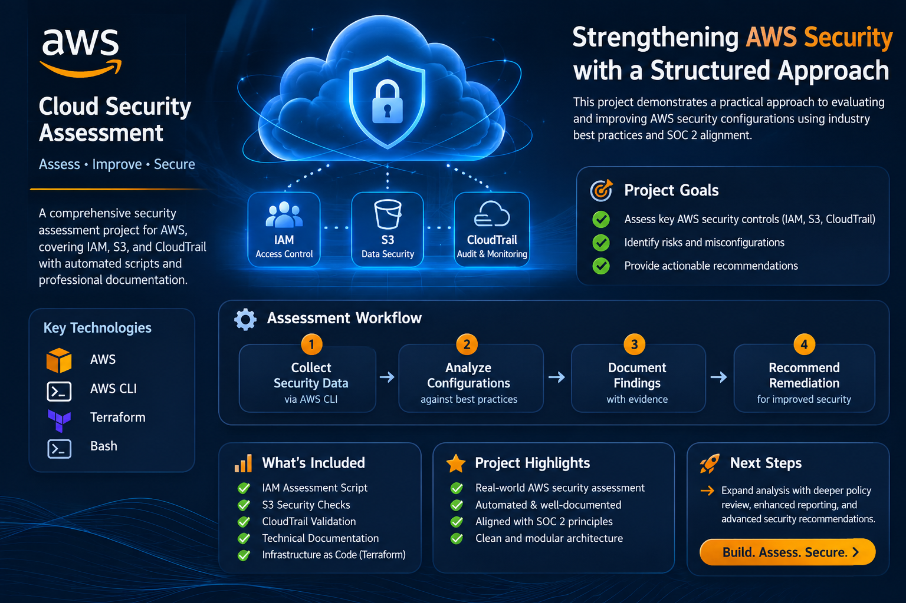

AWS Cloud Security Assessment
<p align="center">    </p>

<p align="center">   <strong>Assess. Analyze. Improve. Secure.</strong> </p>

<p align="center">
  AWS Security | IAM | S3 | CloudTrail | Terraform | AWS CLI | Bash
</p>


## Project Overview

This repository presents a technical summary of an AWS Cloud Security Assessment project I worked on during my freelance engagement.

The project focuses on evaluating AWS security configurations, identifying potential security gaps, collecting technical evidence, and developing practical recommendations to strengthen cloud security.

The assessment covers three key AWS service areas:

- **IAM – Identity and Access Management:** Reviewing identity management, access controls, users, roles, and account-level security settings.
- **S3 – Simple Storage Service:** Evaluating bucket security, public access restrictions, encryption, versioning, and ownership controls.
- **CloudTrail:** Reviewing audit logging, event visibility, and security monitoring configurations.

The assessment approach is informed by AWS security best practices and relevant SOC 2 Trust Services Criteria.

## Assessment Objectives

- Evaluate security configurations across selected AWS services.
- Identify potential security misconfigurations and access-control risks.
- Collect and organize technical evidence.
- Map security observations to relevant security controls.
- Develop actionable remediation recommendations.
- Document assessment results in a structured and reproducible format.

## Assessment Methodology

The project follows a structured security assessment workflow:

```text
AWS Environment
      |
      v
Security Data Collection
      |
      v
Configuration Analysis
      |
      v
Security Gap Identification
      |
      v
Evidence & Findings
      |
      v
Remediation Recommendations
      |
      v
Verification & Documentation
```

## Technical Scope

| AWS Service | Assessment Focus                                 | Status      |
| ----------- | ------------------------------------------------ | ----------- |
| IAM         | Users, roles, password policy, account security  | Implemented |
| S3          | Public access, encryption, versioning, ownership | Implemented |
| CloudTrail  | Audit logging and event monitoring               | Planned     |

## Assessment Modules

### 1. IAM Security Assessment

Evaluates IAM account-level security settings and collects information about users, roles, password policies, and account security indicators.

**Implementation:**

- AWS account identity verification.
- IAM user and role enumeration.
- Account password policy inspection.
- IAM account summary collection.
- Local evidence collection.

**Script:** `scripts/iam-assessment.sh`

**Documentation:** [IAM Security Assessment](docs/iam-assessment.md)

### 2. S3 Security Assessment

Evaluates S3 bucket security configurations and identifies potential data exposure and data protection gaps.

**Implementation:**

- S3 bucket discovery.
- Public access block inspection.
- Server-side encryption inspection.
- Bucket versioning inspection.
- Bucket policy public status inspection.
- Bucket ownership controls inspection.
- Timestamped evidence collection.

**Script:** `scripts/s3-assessment.sh`

**Documentation:** [S3 Security Assessment](docs/s3-assessment.md)

### 3. CloudTrail Security Assessment

The next module will focus on AWS audit logging and monitoring configurations.

Planned assessment areas include:

- CloudTrail trail discovery.
- Multi-region trail configuration.
- Management event logging.
- Log file validation.
- S3 log delivery configuration.
- CloudTrail encryption and monitoring settings.

## Tools & Technologies

| Technology     | Purpose                                           |
| -------------- | ------------------------------------------------- |
| AWS CLI        | AWS security data collection                      |
| Terraform      | Infrastructure as Code and security configuration |
| Bash           | Assessment automation                             |
| jq             | JSON processing                                   |
| Git & GitHub   | Version control and project documentation         |
| SOC 2 Criteria | Security control reference and assessment mapping |

## Repository Structure

```text
aws-cloud-security-assessment/
│
├── assets/
│   └── aws-cloud-security-assessment.png
│
├── docs/
│   ├── architecture.md
│   ├── control-matrix.md
│   ├── project-scope.md
│   ├── iam-assessment.md
│   └── s3-assessment.md
│
├── scripts/
│   ├── iam-assessment.sh
│   └── s3-assessment.sh
│
├── terraform/
│   ├── main.tf
│   ├── outputs.tf
│   ├── provider.tf
│   └── variables.tf
│
├── evidence/
│   ├── iam/
│   └── s3/
│
├── findings/
│
├── README.md
└── LICENSE
```

## Project Documentation

- [Architecture](docs/architecture.md)
- [Project Scope](docs/project-scope.md)
- [Security Control Matrix](docs/control-matrix.md)
- [IAM Assessment Details](docs/iam-assessment.md)
- [S3 Assessment Details](docs/s3-assessment.md)

## Implementation Status

- [x] Project scope and assessment architecture
- [x] Terraform foundation
- [x] IAM assessment automation
- [x] IAM technical documentation
- [x] S3 assessment automation
- [x] S3 technical documentation
- [ ] CloudTrail assessment automation
- [ ] CloudTrail technical documentation
- [ ] Evidence analysis and security findings
- [ ] Remediation recommendations
- [ ] Final assessment report

## Security & Cost Considerations

- Assessment scripts are designed to use read-only AWS API operations where possible.
- Infrastructure deployment is kept separate from assessment and evidence collection.
- Terraform configurations are reviewed and validated before deployment.
- AWS resource creation is subject to explicit cost and permission checks.
- Sensitive account information and raw assessment evidence are excluded from public repository commits.

## Project Outcome

The goal is to deliver a structured and repeatable AWS security assessment approach that combines automated data collection, technical analysis, security control mapping, evidence management, and actionable remediation guidance.

This repository contains selected implementation details and technical documentation from my freelance project experience.

---

\<p align="center">   \<strong>Build. Assess. Secure.\</strong> \</p>

